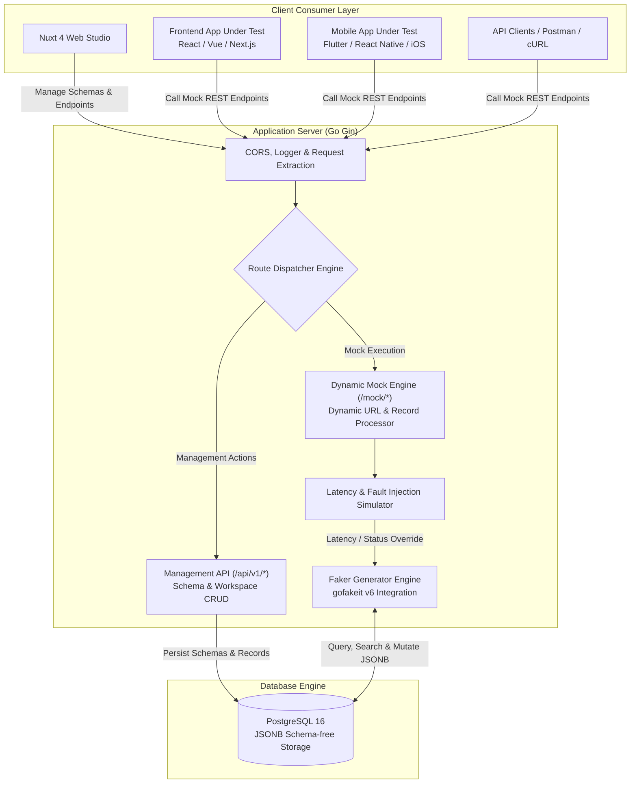

# 🚀 Mock API Generator Server

<p align="center">
  <strong>High-Performance Dynamic RESTful Mock API Engine & Visual Schema Studio</strong><br />
  <em>Accelerate Frontend & Mobile engineering sprints by eliminating backend dependencies and simulating real-world network edge cases.</em>
</p>

<p align="center">
  <a href="https://mock-api-server-drab.vercel.app">
    
  </a>
  
  
  
  
  
  
</p>

<p align="center">
  <a href="https://mock-api-server-drab.vercel.app"><strong>🚀 Live Production Demo</strong></a> •
  <a href="#1-🎯-ปัญหาที่ระบบนี้เข้ามาแก้-business--engineering-pain-points"><strong>🎯 ปัญหาที่ระบบแก้</strong></a> •
  <a href="#2-🏗️-สถาปัตยกรรมระบบ-system-architecture"><strong>🏗️ สถาปัตยกรรมระบบ</strong></a> •
  <a href="#3-🛡️-วิธีรับมือกับเคสยากๆ-ในระบบ-edge-cases--resilience-handled"><strong>🛡️ เคสยากที่ระบบรับมือ</strong></a> •
  <a href="#-api-usage-guide"><strong>📡 API Guide</strong></a>
</p>

---

## 🚀 Live Production Demo

สัมผัสประสบการณ์ใช้งานระบบจริงบน Cloud ได้ทันทีโดยไม่ต้องติดตั้งโปรแกรมในเครื่อง:

| Resource | Link | Description |
| :--- | :--- | :--- |
| 🌐 **Web Studio Dashboard** | [https://mock-api-server-drab.vercel.app](https://mock-api-server-drab.vercel.app) | หน้า Nuxt 4 Web UI สำหรับออกแบบ Schema และจัดการ Endpoints |
| ⚡ **Live Mock Endpoint** | [https://mock-api-server-drab.vercel.app/mock/users](https://mock-api-server-drab.vercel.app/mock/users) | ตัวอย่าง REST Endpoint จริง รองรับ Pagination, Search, Filtering |
| 📦 **GitHub Repository** | [github.com/thanawat-c/mock-api-server](https://github.com/thanawat-c/mock-api-server) | ซอร์สโค้ดเต็ม (Go Gin Backend + Nuxt 4 Frontend) |

```
1. Create Endpoint           2. Configure Schema               3. Instant REST API
┌─────────────────────┐      ┌───────────────────────────┐     ┌───────────────────────────────────┐
│ Path: /users        │ ───► │ name  : faker.name        │───► │ GET  /mock/users?page=1&limit=10  │
│ Delay: 500ms        │      │ email : faker.email       │     │ POST /mock/users                  │
│ Status: 200 (OK)    │      │ avatar: faker.avatar      │     │ PUT  /mock/users/:id              │
└─────────────────────┘      └───────────────────────────┘     └───────────────────────────────────┘
```

---

## 1. 🎯 ปัญหาที่ระบบนี้เข้ามาแก้ (Business & Engineering Pain Points)

ในกระบวนการพัฒนาซอฟต์แวร์แบบ Agile หรือ Scrum ทีมพัฒนามักพบกับ **3 คอขวดใหญ่** ที่ทำให้ Release งานไม่ทันกำหนด:

### ❌ ปัญหาที่ 1: Frontend & Mobile ถูกบล็อกโดย Backend (Development Bottleneck)
- **Pain Point:** ทีม Frontend และ Mobile App ไม่สามารถเริ่มพัฒนาหน้าจอหรือเขียน Business Logic ได้จนกว่าทีม Backend จะออกแบบ Database และส่ง API ให้เสร็จก่อน ส่งผลให้งานล่าช้าไปหลายสัปดาห์
- **วิธีแก้:** ระบบนี้ช่วยให้ทีมสามารถตกลง API Contract กัน แล้วสร้าง **Instant RESTful CRUD Endpoints** ได้ภายใน 30 วินาที ทีม Frontend สามารถเริ่มเขียนโค้ดและทดสอบได้ทันทีในวันแรกของ Sprint

### ❌ ปัญหาที่ 2: ฝันร้ายของการใช้ Hardcoded Mock Data (Unrealistic Testing)
- **Pain Point:** การเขียน Mock Data แบบ Static ไฟล์ `.json` แปะไว้ในโค้ดหน้าบ้าน ไม่สามารถทดสอบพฤติกรรมจริงได้ เช่น การแบ่งหน้า (Pagination), การค้นหา (Fuzzy Search), การเรียงลำดับ (Sorting), หรือการทดสอบการสร้าง/แก้ไข/ลบข้อมูล (POST/PUT/DELETE)
- **วิธีแก้:** ระบบมี **In-Database Dynamic Record Engine** ที่รัน RESTful CRUD เต็มรูปแบบ ข้อมูลที่สร้างใหม่จะถูกบันทึกจริง แก้ไขได้จริง และค้นหาได้จริงผ่าน Query Parameters เสมือนมี Backend Server เต็มรูปแบบ

### ❌ ปัญหาที่ 3: ระบบไม่เคยถูกทดสอบกรณีเน็ตช้าหรือเซิร์ฟเวอร์พัง (Production Edge Case Blindness)
- **Pain Point:** หน้าเว็บและแอปส่วนใหญ่ทำงานได้ดีบนเครื่อง Dev แต่พอขึ้น Production จริงและผู้ใช้เจอเน็ต 3G ช้า หรือ API พ่น HTTP 500 / 401 หน้าจอกลับค้างหรือพัง (Crash) เพราะไม่มีเครื่องมือจำลองสถานการณ์เลวร้าย
- **วิธีแก้:** มีระบบ **Fault Injection & Latency Simulator** สามารถปรับหน่วงเวลาของเซิร์ฟเวอร์ (Latency Slider 0–3000ms) และบังคับสั่งให้ API พ่น Error 400, 401, 404, 500 ได้ตามต้องการ เพื่อทดสอบ Skeleton Loaders, Spinners, และ Error Boundaries ของแอปให้ทนทาน 100%

---

## 2. 🏗️ สถาปัตยกรรมระบบ (System Architecture)

ระบบออกแบบด้วยภาษา **Go (Golang)** สำหรับส่วนประมวลผลความเร็วสูง และ **PostgreSQL JSONB** สำหรับจัดเก็บข้อมูลแบบ Schema-free ไร้ขีดจำกัด:



### สรุปส่วนประกอบทางเทคนิค (Tech Stack Details)
| ชั้นการทำงาน | เทคโนโลยีที่ใช้ | เหตุผลและบทบาททางวิศวกรรม |
|---|---|---|
| **Backend Core** | **Go 1.22+ & Gin Framework** | ประสิทธิภาพสูง การตอบสนองระดับ Microsecond กินแรมน้อย และจัดการ Concurrency ดีเยี่ยม |
| **Data Engine** | **gofakeit v6** | สุ่มข้อมูลจำลองสมจริงกว่า 20 หมวดหมู่ (Personal, Commerce, Address, UUID, Avatars) |
| **Storage Layer** | **PostgreSQL 16 (JSONB)** | จัดเก็บ Record ในรูปแบบ JSONB ยืดหยุ่น ไร้ข้อจำกัดเรื่อง Schema และไม่ต้องรัน Migration |
| **Frontend Studio** | **Nuxt 4 / Vue 3.5** | เว็บสตูดิโอดีไซน์โมเดิร์น โหลดเร็วด้วย SSR/SPA สถาปัตยกรรม Component-driven |
| **UI & Styling** | **TailwindCSS & Element Plus** | หน้าจอใช้งานง่าย พร้อม Built-in Test Console สไตล์ Postman ในเบราว์เซอร์ |

---

## 3. 🛡️ วิธีรับมือกับเคสยากๆ ในระบบ (Edge Cases & Resilience Handled)

### 1. การรองรับ Dynamic Schema เปลี่ยนแปลงได้อิสระโดยไม่ต้องแก้ Database (Zero DDL Migrations)
- **ปัญหา:** หากใช้ตารางฐานข้อมูลทั่วไป ทุกครั้งที่ผู้ใช้เพิ่มหรือลบคอลัมน์ในหน้าเว็บ จะต้องส่งคำสั่ง `ALTER TABLE` ไปแก้ฐานข้อมูล ซึ่งเสี่ยงทำให้ระบบค้างหรือเกิด Deadlock
- **วิธีรับมือ:** ระบบออกแบบโดยใช้ **PostgreSQL JSONB** ร่วมกับ GORM ทำให้โครงสร้างข้อมูลของแต่ละ Endpoint สามารถยืดหยุ่นได้ 100% ผู้ใช้สามารถเพิ่มฟิลด์ประเภทใหม่ได้ทันทีโดยไม่ต้องรัน Migration และยังคงสามารถคิวรีค้นหาข้อมูลภายใน JSON ได้รวดเร็ว

### 2. การค้นหาข้อมูลแบบยืดหยุ่นข้ามทุกคีย์ (Fuzzy Full-Text Search on Unstructured Data)
- **ปัญหา:** เมื่อข้อมูลถูกเก็บเป็น JSON ที่โครงสร้างไม่แน่นอน การทำระบบค้นหา (Search Query) มักทำได้ยากเพราะไม่รู้ล่วงหน้าว่าผู้ใช้จะค้นหาจากฟิลด์ไหน
- **วิธีรับมือ:** เขียน Search Engine ในภาษา Go ให้แตกข้อมูลใน JSONB ออกมาทำการ **Fuzzy Substring Matching แบบ Case-insensitive** ข้ามทุก Key และ Nested Objects ทำให้คำสั่ง `?search=alex` สามารถค้นหาเจอได้ไม่ว่าจะอยู่ในฟิลด์ name, email หรือ description

### 3. การแทรก Error และจำลอง Latency โดยไม่กระทบ Service อื่น (Fault Injection Isolation)
- **ปัญหา:** การทดสอบ Error ในระบบทั่วไปมักต้องไปปิดเซิร์ฟเวอร์หรือแก้โค้ดชั่วคราว ซึ่งทำให้เพื่อนร่วมทีมคนอื่นใช้งานไม่ได้
- **วิธีรับมือ:** ระบบรองรับ **Per-Request Fault Injection**:
  - ส่ง Query Param: `?mock_status=500` หรือ `?mock_status=401`
  - ส่ง HTTP Header: `x-mock-status: 404`
  - ทำให้ Developer แต่ละคนสามารถทดสอบเคสเซิร์ฟเวอร์พังเฉพาะ Request ของตัวเองได้ทันที โดยไม่รบกวนคนอื่นในทีม

### 4. การป้องกันข้อมูลพังจากการยิงทดสอบแบบทำลายล้าง (1-Click Data Reset & Isolation)
- **ปัญหา:** เวลาทีม QA หรือ Automated Test ยิงคำสั่ง `DELETE /mock/users/1` หรือ `PUT` ข้อมูลเดิมจะหายไป ทำให้รอบต่อไปทดสอบไม่ได้
- **วิธีรับมือ:** ระบบมีฟังก์ชัน **Instant Reset Seed Data** ที่สามารถกดปุ่มเดียวเพื่อสร้างข้อมูลสุ่มชุดใหม่ตาม Schema เดิมกลับคืนมาได้ทันทีใน 0.1 วินาที พร้อมระบบ Import/Export ไฟล์ JSON เพื่อนำชุดข้อมูลจำลองไปแชร์ต่อในทีม

---

## 📡 API Usage Guide

### 1. ดึงข้อมูลพร้อมการแบ่งหน้าและการค้นหา (Search & Pagination)
```bash
curl -X GET "https://mock-api-server-drab.vercel.app/mock/users?page=1&limit=5&search=alex"
```

### 2. จำลองข้อผิดพลาด HTTP 500 หรือ 401 (Fault Injection)
```bash
# สั่งผ่าน Query Parameter
curl -X GET "https://mock-api-server-drab.vercel.app/mock/users?mock_status=500"

# สั่งผ่าน Request Header
curl -X GET "https://mock-api-server-drab.vercel.app/mock/users" -H "x-mock-status: 401"
```

### 3. สร้างข้อมูลจำลองรายการใหม่ (POST)
```bash
curl -X POST "https://mock-api-server-drab.vercel.app/mock/users" \
  -H "Content-Type: application/json" \
  -d '{
    "name": "Thanawat Cauynukul",
    "email": "thanawat@example.com",
    "role": "Software Engineer"
  }'
```

### 4. ลบข้อมูลจำลอง (DELETE)
```bash
curl -X DELETE "https://mock-api-server-drab.vercel.app/mock/users/1"
```

---

## 📂 โครงสร้างไดเรกทอรีโปรเจกต์ (Project Structure)

```plaintext
Project-mock-api-server/
├── backend/
│   ├── cmd/api/main.go            # Entrypoint ของแอปพลิเคชัน & ตั้งค่า CORS
│   ├── internal/
│   │   ├── config/                # เชื่อมต่อ Database & Auto-migration
│   │   ├── handlers/              # Controllers สำหรับจัดการ Endpoints, Records และ Mock Engine
│   │   ├── models/                # โครงสร้างฐานข้อมูล GORM (Endpoint, MockRecord)
│   │   ├── routes/                # กำหนด Route APIs & Middleware
│   │   └── services/              # ระบบ Faker Generator, Schema Sync และ Logic คิวรี JSONB
│   ├── go.mod                     # Go Dependencies
│   └── .env.example               # ตัวอย่าง Environment Variables
├── frontend/
│   ├── app.vue                    # Root Nuxt Component
│   ├── pages/                     # หน้าระบบตามโครงสร้าง Nuxt ([id].vue, index.vue, new.vue)
│   ├── components/                # UI Components (TestConsole, SchemaBuilder, DataTable)
│   ├── nuxt.config.ts             # การตั้งค่า Nuxt, Tailwind & Modules
│   └── package.json               # Frontend Dependencies & Scripts
└── README.md                      # เอกสารคู่มือและสถาปัตยกรรมระบบ
```

---

## 👨‍💻 ผู้พัฒนา (Author)

**Thanawat Cauynukul (Kan)**
- สถาบัน: มหาวิทยาลัยเทคโนโลยีพระจอมเกล้าธนบุรี (KMUTT)
- GitHub: [@thanawat-c](https://github.com/thanawat-c)
- Email: [nong540413@gmail.com](mailto:nong540413@gmail.com)

---

## 📄 License

This project is open-source software licensed under the [MIT License](LICENSE).
